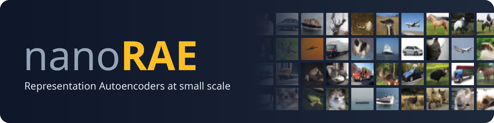
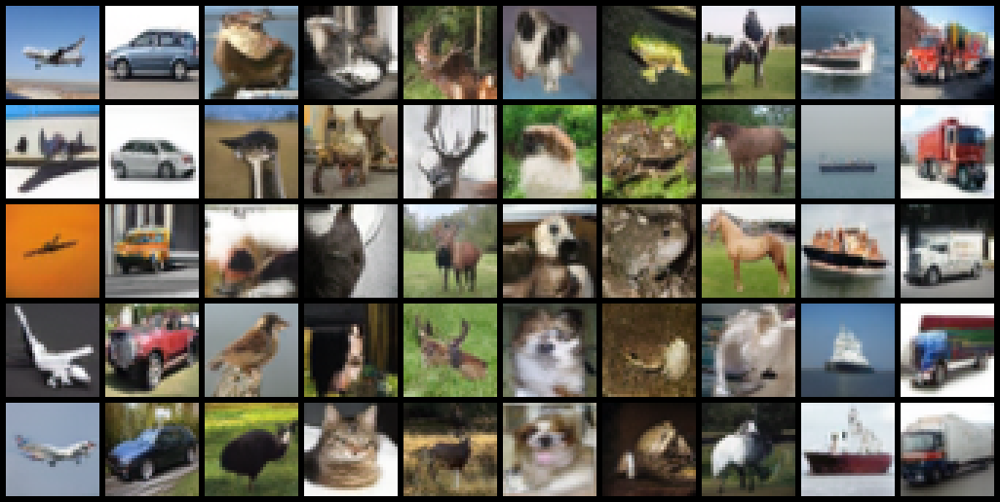

<p align="center">
  
</p>

<p align="center">
  <a href="https://arxiv.org/abs/2510.11690"></a>
  <a href="https://huggingface.co/shumpei777/nanoRAE"></a>
  <a href="https://github.com/shumpei-takezaki/nanoDINO"></a>
  <a href="https://www.python.org/"></a>
  <a href="LICENSE"></a>
</p>

Small-scale reproductions of [Diffusion Transformers with Representation Autoencoders (RAE)](https://arxiv.org/abs/2510.11690)
and follow-up work, on one GPU. Currently on CIFAR-10 (more datasets coming), built on the [official implementation](https://github.com/bytetriper/RAE).

- **Encoder:** a DINOv2 ViT-Tiny/4 (no registers) trained from scratch on CIFAR-10 with
  [nanoDINO](https://github.com/shumpei-takezaki/nanoDINO), frozen. Latent: `[192, 8, 8]` (64 tokens of dim 192).
- **Decoder:** the official ViT decoder (patch 4), trained with L1 + LPIPS (+ GAN) and latent noise augmentation.
- **Generator:** DiT<sup>DH</sup>-S with a 512-wide DDT head, class-conditional (10 classes).

## 📰 Updates

- **2026-11-09 (v0.5):** renamed to nanoRAE; reorganized README and docs (pretrained weights, training, training curves);
  experiments renumbered (RAE first, then RJF); FID reference statistics on Hugging Face; third-party license notices.
- **2026-11-09 (v0.4):** AutoGuidance, RJF ([Learning on the Manifold](https://arxiv.org/abs/2602.10099)), RFM and RJF + AutoGuidance.
  Best FID so far: 6.07.
- **2026-11-06 (v0.3):** weights of all experiments on Hugging Face, organized into folders.
- **2026-11-06 (v0.2):** Stage 2 model size, DDT head, noise-schedule shift and decoder-noise ablations.
- **2026-10-30 (v0.1):** first release: decoder and encoder size, Stage 2 generation, single-image overfitting, latent geometry.

## 📊 Results

Generation on CIFAR-10 (FID on 50k samples against CIFAR-10 train):

| Model | Guidance | FID |
|---|---|---:|
| DiT<sup>DH</sup>-S, official 2048-wide head | – | 13.59 |
| DiT<sup>DH</sup>-S, 512-wide head (default) | – | 7.94 |
| DiT<sup>DH</sup>-S, 512-wide head | AutoGuidance | 6.48 |
| LightningDiT-S/1 + RJF | AutoGuidance | **6.07** |

<p align="center">
  
  <br><em>Uncurated samples (seed 0) from the best model above, one class per column.</em>
</p>

CFG does not help on this latent, as RAE reports for CFG without a guidance interval. The default decoder (ViT-XL + GAN) reaches rFID 5.71
on the CIFAR-10 test set.

All 14 experiments, with the paper result each one reproduces, are listed in [docs/README.md](docs/README.md).

## ⚡ Quick start

```bash
git clone https://github.com/shumpei-takezaki/nanoRAE.git && cd nanoRAE
uv sync                                      # Python 3.12; pulls nanoDINO (encoder definition)
uv run python scripts/prepare_cifar10.py     # downloads CIFAR-10 to data/; writes PNGs, {train,test}.npz and train FID stats (GPU)
```

Sample from the default model with the released weights (about 1.8 GB):

```bash
uv run hf download shumpei777/nanoRAE --local-dir pretrained_models \
  --include stage2/ditdh_s_h512_ema.pt stage1/decoder_vitxl_gan.pt encoders/encoder_dinov2_vit_tiny4.pt stats/normalization_stats.pt
PYTHONPATH=src uv run python src/sample.py --config configs/stage2/sampling/CIFAR10/DiTDH-S-h512_pretrained.yaml   # -> sample.png, one per class
```

`prepare_cifar10.py` is only needed for training and evaluation, not for sampling.

## 📚 Documentation

- [Experiments](docs/README.md): one write-up per experiment, with figures and the commands to reproduce it.
- [Pretrained weights](docs/weights.md): all released encoders, decoders and generators, with their configs.
- [Training from scratch](docs/training.md): commands and training times.
- [Changes from upstream](docs/changes.md): what this repository changes in the official RAE code.

## 🙏 Acknowledgements

- [RAE](https://github.com/bytetriper/RAE) ([Diffusion Transformers with Representation Autoencoders](https://arxiv.org/abs/2510.11690)):
  this repository is built on the official implementation, which in turn builds on [SiT](https://github.com/willisma/sit),
  [DDT](https://github.com/MCG-NJU/DDT), [LightningDiT](https://github.com/hustvl/LightningDiT/) and [MAE](https://github.com/facebookresearch/mae)
  (see the [upstream README](https://github.com/bytetriper/RAE/blob/main/README.md)).
- [nanoDINO](https://github.com/shumpei-takezaki/nanoDINO): the CIFAR-10 DINOv2 encoders and the DINO backbone of the discriminator,
  following [DINO](https://github.com/facebookresearch/dino) and [DINOv2](https://github.com/facebookresearch/dinov2).
- [Learning on the Manifold (RJF)](https://arxiv.org/abs/2602.10099): the analyses in experiments 10 and 11 and the reproduction in experiments 12-14.

## 📝 Citation

If you use this repository, please cite it:

```bibtex
@misc{takezaki2026nanorae,
      title={nanoRAE: Small-Scale Reproductions of Representation Autoencoders},
      author={Shumpei Takezaki},
      year={2026},
      howpublished={\url{https://github.com/shumpei-takezaki/nanoRAE}},
}
```

and the RAE paper, on which this work is based:

```bibtex
@misc{zheng2025diffusiontransformersrepresentationautoencoders,
      title={Diffusion Transformers with Representation Autoencoders},
      author={Boyang Zheng and Nanye Ma and Shengbang Tong and Saining Xie},
      year={2025},
      eprint={2510.11690},
      archivePrefix={arXiv},
      primaryClass={cs.CV},
      url={https://arxiv.org/abs/2510.11690},
}
```

If you use the RJF experiments (10-14), please also cite:

```bibtex
@misc{kumar2026learningmanifold,
      title={Learning on the Manifold: Unlocking Standard Diffusion Transformers with Representation Encoders},
      author={Amandeep Kumar and Vishal M. Patel},
      year={2026},
      eprint={2602.10099},
      archivePrefix={arXiv},
      primaryClass={cs.LG},
      url={https://arxiv.org/abs/2602.10099},
}
```

## 📄 License

MIT ([LICENSE](LICENSE)), as the [official RAE implementation](https://github.com/bytetriper/RAE) it builds on.
Some third-party parts keep their own licenses, and two of them are **for non-commercial use only** (the RAEv2-derived
x-prediction / internal guidance, CC BY-NC 4.0, and `src/disc/diffaug.py` from StyleGAN-T): see [THIRD_PARTY_NOTICES.md](THIRD_PARTY_NOTICES.md).
