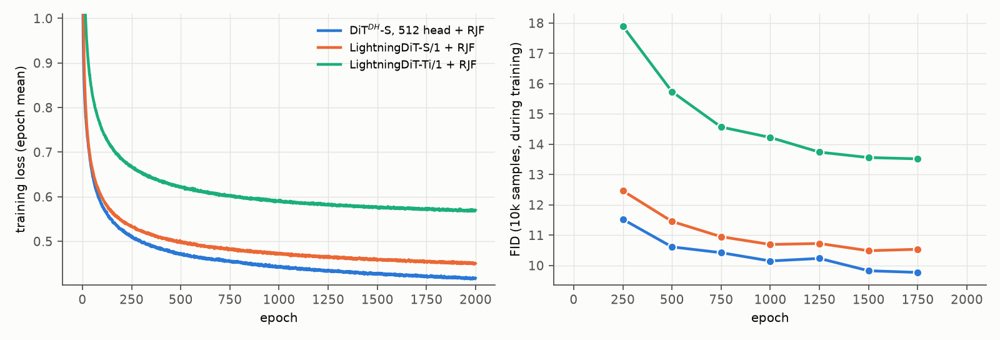

# 12. RJF: flow matching on the sphere (Learning on the Manifold)

- **Status:** done
- **Paper:** Learning on the Manifold (RJF, [arXiv 2602.10099](https://arxiv.org/abs/2602.10099)), Alg. 1-2, Tables 3-4

## Goal

Encoder features lie on a sphere, while linear flow matching cuts through its inside ([10](10_latent_geometry.md)). RJF trains on
the sphere instead and reports that a plain DiT with width = token dim then trains well (FID 24.32 → 6.77 with LightningDiT-B/1 on
DINOv2-B), without width scaling. A plain DiT with width = n diverged in our setting ([06](06_ddt_head.md)), so we test whether RJF fixes it,
and whether it also improves the two best models.

## Setup

Following Alg. 1-2 (`src/stage2/transport/spherical.py`, `path_type: 'Spherical'`):

- Training: data and noise are projected to the unit sphere, connected by slerp, the prediction is projected to the tangent space, and the
  loss is the tangent MSE with the Jacobi weight sinc²((1 − t)Ω). Time distribution and shift are unchanged (α ≈ 1.73).
- Sampling: 50 Euler steps along geodesics (exponential map), then the result is scaled to radius R before decoding.

Choices the paper leaves open: spheres are **per token**; the projected latent is the **normalized** Stage 2 latent, as in the other
experiments; no guidance (CFG does not help here, [05](05_stage2_model_size.md), and the paper's AutoGuidance is not used).

Projecting the normalized latent loses almost nothing (reconstruction of test 10k with the XL GAN decoder):

| | No projection | R = 13 | R = 13.66 | R = 15 | R = 18 | R = 22 |
|---|---|---|---|---|---|---|
| rFID | 5.70 | 5.57 | 5.71 | 6.15 | 6.91 | 7.91 |
| PSNR | 22.35 | 22.52 | 22.35 | 22.05 | 21.71 | 21.42 |

As an implementation check, RJF on a single image ([03](03_single_image_overfit.md)) reaches loss 0.0013 at width 64 and samples within 56 dB
of the RAE reconstruction, compared with 29.2 dB for plain flow matching at that width.

Same recipe as [06](06_ddt_head.md) otherwise (2000 epochs, FID 10k every 250 epochs). Final evaluation: 50k FID, no CFG, for R = 13, 13.66, 15, 18.

| Model | Params | Baseline FID (no RJF) |
|---|---|---|
| LightningDiT-Ti/1 (width = n) | 8.3M | 235.6 (diverged) |
| LightningDiT-S/1 | 32.8M | 8.70 |
| DiT<sup>DH</sup>-S, head 512 | 42.8M | 7.94 |

Configs: `configs/stage2/{training,sampling}/CIFAR10/{LightningDiT-Ti,LightningDiT-S,DiTDH-S-h512}-RJF_dinov2-r0_decXL-gan.yaml`

## Results

Final epoch, EMA, 50k samples, no CFG. R is the radius the samples are scaled to before decoding (13.66 is the mean token norm of
the data, our reference value; the others are reported for comparison with the paper, which also finds a larger R better).

| Model | Params | Without RJF | RJF, R = 13 | **RJF, R = 13.66** | RJF, R = 15 | RJF, R = 18 |
|---|---|---|---|---|---|---|
| LightningDiT-Ti/1 (width = n) | 8.3M | 235.6 (diverged) | 12.76 | **11.54** | 10.23 | 9.22 |
| LightningDiT-S/1 | 32.8M | 8.70 | 8.97 | **8.22** | 7.46 | 6.97 |
| DiT<sup>DH</sup>-S, head 512 | 42.8M | 7.94 | 8.49 | **7.81** | 7.18 | **6.81** |

FID (10k samples) during training:

| Model | 250 | 500 | 750 | 1000 | 1250 | 1500 | 1750 |
|---|---|---|---|---|---|---|---|
| Ti/1 without RJF ([06](06_ddt_head.md)) | 29.2 | 43.9 | 38.8 | 37.0 | 38.0 | 167.6 | 221.3 |
| Ti/1 + RJF | 17.90 | 15.74 | 14.57 | 14.22 | 13.74 | 13.56 | 13.52 |
| S/1 without RJF | 14.02 | 12.47 | 11.82 | 11.49 | 11.17 | 11.00 | 11.04 |
| S/1 + RJF | 12.47 | 11.45 | 10.95 | 10.69 | 10.73 | 10.49 | 10.53 |
| Head 512 without RJF | 11.47 | 10.84 | 10.58 | 10.19 | 10.32 | 10.04 | 9.89 |
| Head 512 + RJF | 11.53 | 10.61 | 10.42 | 10.15 | 10.23 | 9.83 | 9.77 |

Inception Score (R = 13.66): Ti/1 8.60, S/1 9.11, head 512 9.29 (without RJF: S/1 8.99, head 512 9.22).

Memorization (R = 13.66; criteria as in [05](05_stage2_model_size.md)): 0% for all three by the Gu criterion; the Carlini score counts
2 / 6 / 5 distinct training images for Ti/1 / S/1 / head 512 (13 for the head-512 model without RJF).

- **RJF makes the plain DiT with width = n trainable.** Ti/1 no longer diverges (final loss 0.57; without RJF the loss jumped at epochs ~290
  and ~1200) and reaches FID 11.54. This reproduces the main claim of RJF (plain LightningDiT-B/1 on DINOv2-B: 24.32 → 6.77).
  We did not separate the effect of the geometry from other changes RJF makes (unit-norm inputs, the loss scale), nor compare with
  other ways to stabilize training such as a lower learning rate.
- **The gain shrinks as the model gets wider:** at R = 13.66, Ti/1 235.6 → 11.54, S/1 8.70 → 8.22, head 512 7.94 → 7.81.
  This fits the paper's view that RJF matters most when the width is close to the token dim.
- **A larger output radius R gives a better FID** for every model, as in the paper (R ≈ 45 beat the native 27.7 on DINOv2-B). With R = 18,
  the plain S/1 (6.97) beats the head-512 model without RJF (7.94). Reconstruction alone prefers R ≈ 13 (rFID 5.57 at 13 vs. 6.91 at 18),
  so the effect is specific to generated latents; we do not know why. R = 18 is the edge of the tested range, and choosing the best R
  on the same FID is optimistic, so the R = 13.66 numbers are the fair comparison.
- One seed per model.

### Training curves



Left: training loss (epoch mean). Right: FID on 10k samples during training (against CIFAR-10 train), every 250 epochs; the last one is at epoch 1750, and the 50k FIDs at epoch 2000 are in the table above. R = 13.66 during training. Data: [curves.json](../figures/12_rjf/curves.json).

## Reproduce

```bash
scripts/train_stage2.sh configs/stage2/training/CIFAR10/LightningDiT-Ti-RJF_dinov2-r0_decXL-gan.yaml rjf_lightningdit_ti_decXLgan
scripts/eval_stage2.sh configs/stage2/sampling/CIFAR10/LightningDiT-Ti-RJF_dinov2-r0_decXL-gan.yaml rjf_lightningdit_ti_decXLgan_last_R13.66 1.0
# other R: change sphere_radius in the sampling config; likewise for LightningDiT-S-RJF and DiTDH-S-h512-RJF
```
