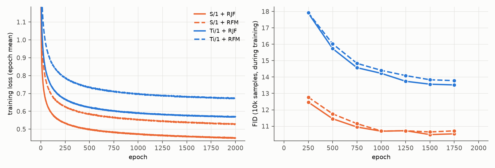

# 13. RJF ablation: without the Jacobi loss weight (RFM)

- **Status:** done
- **Paper:** RJF (Learning on the Manifold) Table 3 (LightningDiT-B/1 on DINOv2-B, 80 epochs: EFM 24.32, + SN 21.99, + RFM 7.06, + RJF 6.77)

## Goal

RJF combines the spherical geometry (slerp path, tangent velocity, geodesic sampling) with a Jacobi weight sinc²((1 − t)Ω) on the loss.
In the paper most of the gain comes from the geometry (RFM). We train RFM, i.e. RJF with the weight set to 1 (`jacobi_weight: false`),
to see which part made the plain DiT with width = n trainable in [12](12_rjf.md).

## Setup

As in [12](12_rjf.md), only without the weight. LightningDiT-Ti/1 (width = n) and LightningDiT-S/1; 2000 epochs; 50k FID and IS at R = 13.66 and 18;
memorization at R = 13.66.

| Model | Linear flow matching | RFM | RJF |
|---|---|---|---|
| LightningDiT-Ti/1 | 235.6 (diverged) | 11.80 | 11.54 |
| LightningDiT-S/1 | 8.70 | 8.28 | 8.22 |

(R = 13.66 for RFM and RJF.)

Configs: `configs/stage2/{training,sampling}/CIFAR10/LightningDiT-{Ti,S}-RFM_dinov2-r0_decXL-gan.yaml`

## Results

50k samples, FID / IS.

| Model | RFM, R = 13.66 | RFM, R = 18 | RJF, R = 13.66 | RJF, R = 18 |
|---|---|---|---|---|
| LightningDiT-Ti/1 | 11.80 / 8.59 | 9.41 / 8.91 | 11.54 / 8.60 | 9.22 |
| LightningDiT-S/1 | 8.28 / 9.02 | 7.09 / 9.32 | 8.22 / 9.11 | 6.97 |

FID (10k samples) during training:

| Model | 250 | 500 | 750 | 1000 | 1250 | 1500 | 1750 |
|---|---|---|---|---|---|---|---|
| Ti/1, RFM | 17.92 | 16.02 | 14.83 | 14.41 | 14.09 | 13.83 | 13.78 |
| Ti/1, RJF | 17.90 | 15.74 | 14.57 | 14.22 | 13.74 | 13.56 | 13.52 |
| S/1, RFM | 12.77 | 11.75 | 11.15 | 10.70 | 10.72 | 10.65 | 10.72 |
| S/1, RJF | 12.47 | 11.45 | 10.95 | 10.69 | 10.73 | 10.49 | 10.53 |

Memorization (R = 13.66): 0% by the Gu criterion for both; the Carlini score counts 2 distinct training images for each.

- **The geometry alone is enough to train the plain DiT with width = n:** Ti/1 trains stably with RFM (11.80), as with RJF (11.54),
  while the linear path diverged.
- **The Jacobi weight adds little:** 0.06-0.26 FID across models and radii, always in favour of RJF. This matches RJF Table 3
  (RFM 7.06 → RJF 6.77): most of the gain comes from the geometry.
- One seed per model, so differences of 0.1-0.2 may be noise.

### Training curves



Left: training loss (epoch mean). Right: FID on 10k samples during training (against CIFAR-10 train), every 250 epochs; the last one is at epoch 1750, and the 50k FIDs at epoch 2000 are in the table above. R = 13.66 during training. RJF and RFM weight the loss differently (RFM has no Jacobi weight), so only the FIDs compare directly. Data: [curves.json](../figures/13_rfm/curves.json).

## Reproduce

```bash
scripts/train_stage2.sh configs/stage2/training/CIFAR10/LightningDiT-Ti-RFM_dinov2-r0_decXL-gan.yaml rfm_lightningdit_ti_decXLgan
scripts/eval_stage2.sh configs/stage2/sampling/CIFAR10/LightningDiT-Ti-RFM_dinov2-r0_decXL-gan.yaml rfm_lightningdit_ti_decXLgan_last_R13.66 1.0
```
