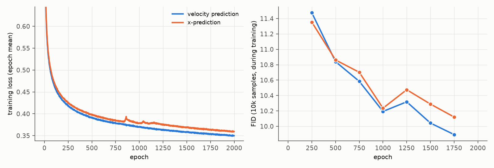

# 15. RAEv2: x-prediction

- **Status:** done
- **Paper:** RAEv2 ([Improved Baselines with Representation Autoencoders](https://arxiv.org/abs/2605.18324)), Stage 2 recipe;
  [official code](https://github.com/nanovisionx/RAEv2) (commit `8a0d238`)

## Goal

RAEv2 trains its generator to predict the clean latent x̂ instead of the velocity. We check whether this change alone helps on CIFAR-10,
keeping everything else of our default model.

## Setup

- Model: DiT<sup>DH</sup>-S with a 512-wide head ([05](05_stage2_model_size.md), FID 7.94 with velocity prediction), same recipe
  (2000 epochs, shift ≈ 1.73, no guidance). Only the prediction target changes.
- Loss and sampling as in the official code (t = 1 is noise): the network outputs x̂, the loss is ((x − x̂) / max(t, 0.05))², which is the
  velocity MSE with the predicted velocity v̂ = (x_t − x̂) / max(t, 0.05), and the sampler integrates this v̂.
- The rest of the RAEv2 recipe (Muon-type optimizer, token conditioning, EMA 0.9995, short schedule) is not used.

Configs: `configs/stage2/training/CIFAR10/DiTDH-S-h512-xpred_dinov2-r0_decXL-gan.yaml`,
`configs/stage2/sampling/CIFAR10/DiTDH-S-h512-xpred_dinov2-r0_decXL-gan.yaml`

## Results

50k samples, FID against CIFAR-10 train, no guidance:

| Prediction | FID | IS |
|---|---:|---:|
| velocity ([05](05_stage2_model_size.md)) | **7.94** | 9.22 |
| x | 8.22 | 9.26 |

- **x-prediction alone does not help here:** FID 8.22 vs. 7.94; IS is about the same. The training curves (below) follow each other closely,
  with x-prediction slightly behind from epoch 1000 on.
- This is a small, 64-token latent with a model much wider than a token (head 512 vs. 192 channels); the case where x-prediction is
  expected to matter most, high-dimensional tokens and a narrow model, is not tested here.
- No memorization by the Gu et al. criterion (0%; Carlini score < 1 for 0.04% of the samples, test images: 1.5%). Details in [16](16_internal_guidance.md#memorization).
- One seed.

### Training curves



Left: training loss (epoch mean; both are velocity MSEs). Right: FID on 10k samples during training (against CIFAR-10 train), every
250 epochs; the last one is at epoch 1750. Data: [curves.json](../figures/15_x_prediction/curves.json).

## Reproduce

```bash
scripts/train_stage2.sh configs/stage2/training/CIFAR10/DiTDH-S-h512-xpred_dinov2-r0_decXL-gan.yaml xpred_ditdh_s_h512_decXLgan
scripts/eval_stage2.sh configs/stage2/sampling/CIFAR10/DiTDH-S-h512-xpred_dinov2-r0_decXL-gan.yaml xpred_ditdh_s_h512_decXLgan_last 1.0
```
