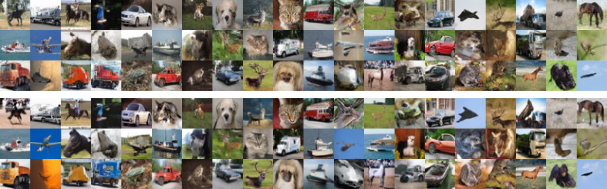
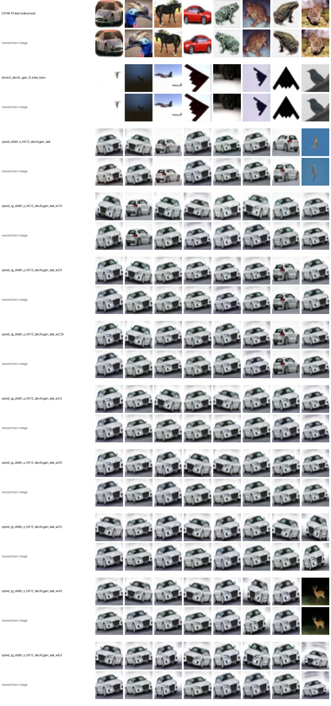
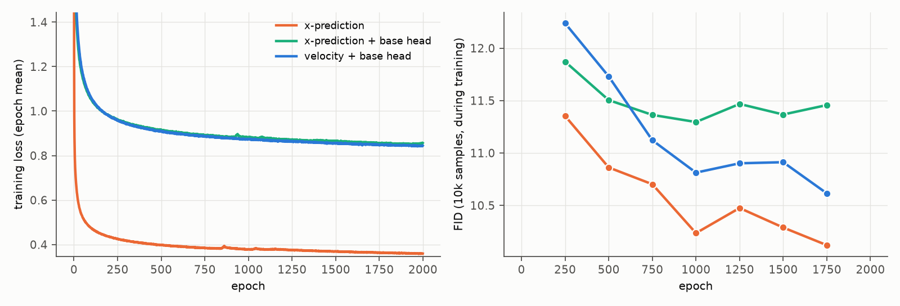

# 16. RAEv2: base head and internal guidance (REPA Guidance)

- **Status:** done
- **Paper:** RAEv2 ([Improved Baselines with Representation Autoencoders](https://arxiv.org/abs/2605.18324)), Sec. 2.3, Tables 16-17;
  [official code](https://github.com/nanovisionx/RAEv2) (commit `8a0d238`)

## Goal

RAEv2 adds a light output head on an early layer of the generator, trained to predict the clean latent with the same loss as the full model.
Since the latent is the encoder's representation, this acts like REPA at an intermediate layer; the paper calls it the **REPA head**.
At sampling, the shallow head serves as a built-in weak model for guidance, x̂ = x̂_base + w(x̂_full − x̂_base)
(**REPA Guidance**, a form of internal guidance), with no separate guide model (AutoGuidance) and no extra forward pass (CFG).
We check whether it helps on CIFAR-10 and compare it with AutoGuidance ([09](09_autoguidance.md)).

## Setup

- Model: the x-prediction DiT<sup>DH</sup>-S with a 512-wide head of [15](15_x_prediction.md), plus a base head after body block 4 of 12
  (official: 8 of 28). The base head is one output layer (RMSNorm, adaLN on the timestep, linear; zero-initialized) on the block-4 tokens.
  2000 epochs, otherwise the same recipe.
- Loss: the x-prediction loss of [15](15_x_prediction.md) on both outputs, summed (weight 1, as in the official code). No separate REPA loss
  (the official code has one, off by default and not used in its ImageNet config).
- Guidance at sampling, as in the official code: one forward pass gives both outputs; x̂ = x̂_base + w(x̂_full − x̂_base) for t ∈ [0.1, 1]
  (t = 1 is noise), x̂_full below. w = 1 is no guidance. The official ImageNet setting is w = 1.78. (The paper writes Eq. 3 as
  x̂_full + w(x̂_full − x̂_base), i.e. its w is ours minus 1; we follow the code.)
- Unlike RAEv2, the body keeps RAE's adaLN conditioning (RAEv2 feeds the class and timestep as tokens), and the optimizer, schedule and EMA
  are unchanged.

Configs: `configs/stage2/training/CIFAR10/DiTDH-S-h512-xpred-IG_dinov2-r0_decXL-gan.yaml`,
`configs/stage2/sampling/CIFAR10/DiTDH-S-h512-xpred-IG_dinov2-r0_decXL-gan.yaml`

## Results

50k samples, FID against CIFAR-10 train / IS:

| Model | w = 1.0 | 1.5 | 1.78 | 2.0 | 2.5 | **3.0** | 3.5 | 4.0 | 5.0 |
|---|---|---|---|---|---|---|---|---|---|
| x-prediction + base head | 9.66 / 9.30 | 7.56 / 9.57 | 6.62 / 9.68 | 5.99 / 9.71 | 5.05 / 9.74 | **4.70** / 9.76 | 4.97 / 9.73 | 5.73 / 9.72 | 8.84 / 9.41 |

(w = 1.25: 8.54 / 9.44; w = 2.25: 5.43 / 9.72.) For comparison, without a base head: 8.22 (x-prediction, [15](15_x_prediction.md)),
7.94 (velocity, [05](05_stage2_model_size.md)); with AutoGuidance 6.48 ([09](09_autoguidance.md)); the best before this, RJF + AutoGuidance, 6.07 ([14](14_rjf_autoguidance.md)).

- **REPA Guidance gives the best FID so far: 4.70** at w = 3.0, against 6.48 for AutoGuidance and 6.07 for RJF + AutoGuidance,
  with a single model and about one forward pass per step. The ranking of the guidance methods is the paper's (Table 16, K = 7:
  no guidance 1.65, CFG 1.49, AutoGuidance 1.14, REPA Guidance 1.06).
- **The base head alone hurts:** without guidance (w = 1) FID is 9.66, worse than the same model without the head (8.22); the FID during
  training stays about 1 above it throughout (below). The early blocks now also have to predict the latent on their own.
  Guidance more than makes up for it.
- **The best scale is much larger than the official 1.78:** FID keeps improving up to w = 3.0 and gets worse beyond (8.84 at 5.0).
  IS also peaks at 3.0. Unlike CFG ([05](05_stage2_model_size.md)), the guidance does not trade FID for IS here.
- Visually, w = 3.0 gives sharper, more saturated samples than w = 1.0, with the same layout for the same noise and no visible artifacts:



(Top three rows: w = 1.0; bottom three rows: w = 3.0; the same initial noise and labels.)

- One seed. The depth of the base head (4 of 12) was not varied; the paper has no ablation of it either.

### x- vs. velocity prediction

The paper's Table 17 (K = 7, 80 epochs, no guidance) compares the original internal guidance (1.87) with x-prediction + REPA head (1.65),
crediting the reparameterization to x-prediction. To separate the two, the same model is trained with velocity prediction: the base head
also predicts the velocity, both outputs get the velocity MSE, and the guidance is applied to the velocity (the same as guiding x̂, since
the conversion between them is affine).

50k samples, FID / IS:

| Prediction (with base head) | w = 1.0 | 2.0 | 2.5 | 3.0 | 3.5 |
|---|---|---|---|---|---|
| velocity | **8.76** / 8.99 | 5.66 / 9.45 | 5.45 / 9.52 | 5.97 / 9.57 | 6.94 / 9.53 |
| x | 9.66 / 9.30 | 5.99 / 9.71 | 5.05 / 9.74 | **4.70** / 9.76 | 4.97 / 9.73 |

- **With guidance, x-prediction is better:** its best FID is 4.70 (w = 3.0) against 5.45 for velocity (w = 2.5), and its IS is higher at every
  scale. This is the direction of the paper's Table 17.
- **Without guidance it is the other way round:** velocity 8.76, x 9.66 (as without the head: velocity 7.94, x 8.22, [15](15_x_prediction.md)).
  The FID during training (below) is also about 0.5 lower for velocity. The benefit of x-prediction shows only under guidance:
  it tolerates stronger guidance before FID turns up (best w 3.0 vs. 2.5).
- Velocity with the base head and guidance (5.45) still beats AutoGuidance (6.48) and RJF + AutoGuidance (6.07).

Configs: `configs/stage2/{training,sampling}/CIFAR10/DiTDH-S-h512-vpred-IG_dinov2-r0_decXL-gan.yaml`

### Memorization

Same method as [05](05_stage2_model_size.md#memorization) (Gu et al. main criterion, Carlini et al. score as a supplement).

| | Gu: d1/d2 < 1/3 | Carlini: score < 1 | Carlini: distinct train images | Median d1 |
|---|---|---|---|---|
| CIFAR-10 test (10k, reference) | 0.19% | 1.49% | 149 | 9.11 |
| x-prediction, no head ([15](15_x_prediction.md)) | **0%** | 0.036% | 18 | 8.93 |
| + base head, w = 1.0 | **0%** | 0.040% | 18 | 8.85 |
| w = 2.0 | 0.002% | 0.130% | 48 | 9.06 |
| w = 3.0 | **0%** | 0.226% | 77 | 9.25 |
| w = 4.0 | **0%** | 0.260% | 82 | 9.40 |
| w = 5.0 | **0%** | 0.248% | 77 | 9.52 |
| velocity + base head, w = 1.0 | **0%** | 0.028% | 13 | 8.95 |
| velocity, w = 2.5 | **0%** | 0.122% | 34 | 9.37 |
| velocity, w = 3.0 | **0%** | 0.140% | 36 | 9.50 |



(For each input, the 8 samples with the lowest Carlini score, above their nearest training images.)

- **No model memorizes by the Gu criterion** (at most one sample in 50k).
- **Stronger guidance gives more near-copies by the Carlini score** (x-prediction: 18 → 77 distinct training images from w = 1 to 3; velocity: 13 → 36), still well below
  the rate of real test images (1.49%). The closest samples are almost all the heavily duplicated white car of CIFAR-10, as for the
  models of [05](05_stage2_model_size.md); guidance pulls more samples towards it. The median nearest-neighbour distance grows with w,
  so samples do not move closer to the training set overall.

### Training curves



Left: training loss (epoch mean; with the base head it is the sum of both losses, so it is not on the same scale as the model without it).
Right: FID on 10k samples during training without guidance (against CIFAR-10 train), every 250 epochs; the last one is at epoch 1750.
Data: [curves.json](../figures/16_internal_guidance/curves.json).

## Reproduce

```bash
scripts/train_stage2.sh configs/stage2/training/CIFAR10/DiTDH-S-h512-xpred-IG_dinov2-r0_decXL-gan.yaml xpred_ig_ditdh_s_h512_decXLgan
scripts/eval_stage2.sh configs/stage2/sampling/CIFAR10/DiTDH-S-h512-xpred-IG_dinov2-r0_decXL-gan.yaml xpred_ig_ditdh_s_h512_decXLgan_last_w3.0 3.0
# velocity variant: the same with DiTDH-S-h512-vpred-IG_dinov2-r0_decXL-gan.yaml
```

The last argument of `eval_stage2.sh` is the guidance scale w.
